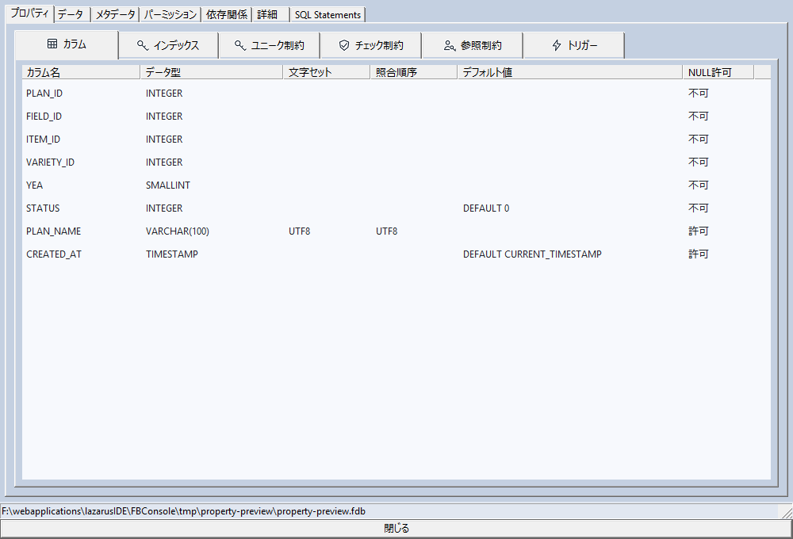
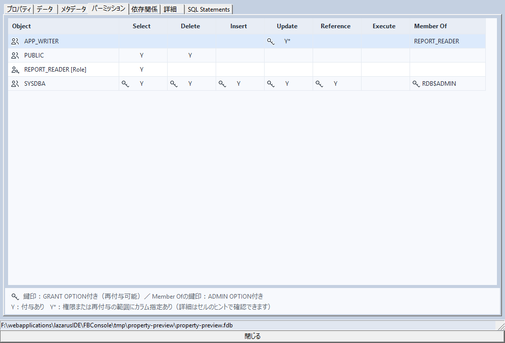

# FBConsole

Firebird 5のWindows / Linux向けデータベース管理ツールです。Lazarus / Free Pascalで開発しています。

**0.3.79 UI更新1（開発版）** — 作成 164SYSTEMS / 開発支援 OpenAI Codex

## ダウンロード

今回のWindows版は [0.3.79 UI更新1](https://github.com/trip350z/FBConsole/releases/tag/v0.3.79-ui1) から取得してください。ZIPを展開し、`FBConsole.exe`を実行します。Firebird 5の64ビットクライアントは別途必要です。

| 最新の配布ファイル | 内容 |
| --- | --- |
| FBConsole-0.3.79-ui1-win64.zip | 今回の画面改善を反映したWindows 64ビット版。本体、説明書、確認用画面画像を同梱 |
| SHA256SUMS.txt | UI更新版のZIPと画像のハッシュ |

既存のWindowsセットアップ、Linux版、日本語PDFガイドは [0.3.79リリース](https://github.com/trip350z/FBConsole/releases/tag/v0.3.79) で配布しています。これらはUI更新前の版です。今回のUI更新版についてはWindowsでビルドと実画面を確認しており、Linuxのビルド・表示確認は未実施です。

| 配布ファイル | 内容 |
| --- | --- |
| FBConsole-0.3.79-win64-SetupBuilder.exe | Windows 64ビット版の日本語セットアップ。本体とガイドを同梱 |
| FBConsole-0.3.79-linux-x86_64-qt6.tar.gz | Linux x86_64 / Qt6版。本体、アイコン、ガイドを同梱 |
| FBConsole_UsersGuide_ja_0.3.79.pdf | 実画面と操作説明を掲載した日本語ガイド |
| SHA256SUMS.txt | 配布ファイルのハッシュ |

## UI更新1の変更

- 淡い配色と、上部ツールバー・WORKペインの角丸枠。
- 47種類のシンプルなモノクロ操作アイコン。接続状態の印は緑（接続）／赤（未接続）。
- コンソールメニューにオプションとハイライト設定を追加。コミット方法、画面／SQLフォント、要素別の色・文字スタイルを保存できます。
- カラム・索引・各種制約・トリガーのタブ、列幅、行間、日本語の見出しを調整。
- パーミッションを対象ごとの権限表に変更。GRANT/ADMIN OPTIONとカラム単位の範囲を区別します。
- メタデータ抽出時の存在しないシステム列参照を修正。

Windowsでビルド、設定の保存・復元、Firebird 5のテスト用DBで権限表・SQL・テーブルCRUDの回帰テストを確認しています。





## 主な機能

- ローカル・リモートのサーバー登録と接続
- 複数DBへの同時接続と、ツリーによる操作対象の切り替え
- テーブル、ビュー、ルーチン、シーケンス、トリガー、権限などの参照
- 対話型SQL、履歴、クエリビルダー、実行計画、CSV出力
- 複数文SQLとSET TERMの実行
- 主キーを持つ通常テーブルの編集とBLOB内容の参照
- DB作成・削除、バックアップ・リストア、スイープ、検証
- ユーザー管理、サーバーログ、各種プロパティ表示

## Windowsで使う

セットアップEXEを実行し、ウィザードでインストール先を選びます。スタートメニューから起動し、接続設定でFirebird 5の64ビット版 **fbclient.dll** を指定してください。Firebirdクライアントは別途用意します。

セットアップは、ワークスペースのSetupBuilder（Inno Setupを利用）で作成しています。

## Linuxで使う

公開バイナリはUbuntu 26.04 / x86_64 / Qt6でビルドしています。Qt6、LazarusのQt6バインディング **libQt6Pas.so.6** とFirebird 5クライアントが必要です。

```sh
tar -xzf FBConsole-0.3.79-linux-x86_64-qt6.tar.gz
cd FBConsole-0.3.79-linux-x86_64-qt6
./FBConsole-0.3.79
```

接続設定で **libfbclient.so** のパスを指定してください。WSL 2ではWSLgなどのGUI環境が必要です。WSLg上では、明示指定がない場合にX11バックエンドを使用します。

依存関係は `ldd ./FBConsole-0.3.79` で確認できます。別のディストリビューションや古い環境で起動できない場合は、その環境でソースからビルドしてください。

## 接続設定と操作ガイド

初回起動時の接続先は空です。設定は実行ファイルの隣の **config/connections.ini** に保存するため、実行フォルダーに書き込み権限が必要です。パスワードは保存しません。リモートDBのパスはサーバー上のパスを指定します。

[日本語ユーザーズガイド](docs/FBConsole_UsersGuide_ja_0.3.79.pdf)に、画面と操作手順を掲載しています。

## コンソールのオプション

「コンソール → オプション」で対話型SQLの自動／手動コミット、引用符外の識別子の大文字化、画面フォントを設定できます。コミットの初期値は手動で、未確定SQLがある間はコミット方法の変更を止めます。自動コミットでは、SQLまたはスクリプトが正常終了した時点で確定します。エラー時は手動でコミット／ロールバックしてください。言語は現在Japaneseのみです。

「コンソール → ハイライト・オプション」でSQLの要素別の前景・背景色、太字・斜体・下線、SQLフォントをプレビュー付きで変更できます。設定は対話型SQLとテーブルのSQL文表示へ反映します。引用符内の文字列・識別子とコメントは大文字化しません。

設定は実行ファイルの隣の **config/options.ini** に保存します。「適用」は保存して開いたまま、「OK」は保存して閉じます。「キャンセル」は最後に適用してからの変更を破棄します。テーブル画面の編集トランザクションは独立しています。

## テーブルのプロパティとパーミッション

プロパティ内のカラム・インデックス・各種制約・トリガーは、余白と行間を広げ、内容に合わせた列幅と日本語の見出しで表示します。列幅は手動でも調整できます。長いカラム定義やSQLはセル／行のヒントでも確認できます。

パーミッションは対象ごとに **Object / Select / Delete / Insert / Update / Reference / Execute / Member Of** を横並びで表示します。明示的に付与された権限を `Y`、GRANT OPTION付きの付与を鍵印で示します。権限または再付与の範囲にカラム指定がある場合は `Y*` とし、対象カラムと付与者をヒントで確認できます。Member Ofには、その対象が直接所属するロールを表示し、ADMIN OPTIONがあれば鍵印を付けます。同名のユーザーとロールは別の対象として扱います。ロールから継承する実効権限の展開は行いません。

[Firebird 5の権限メタデータ](https://www.firebirdsql.org/file/documentation/chunk/en/refdocs/fblangref50/fblangref-appx04-userprivs.html)に沿って表示しています。

## ソースからビルド

Lazarus / Free Pascal、LCL、SynEdit、Printer4Lazarusを使用します。

WindowsではLazarusで **FBConsole.lpi** を開いてビルドします。**build-windows.ps1** のツールパスを環境に合わせて実行する方法もあります。

LinuxではLCLのQt6ユニットとバインディングを用意して、次を実行します。

```sh
sh build-linux.sh qt6
```

生成先は **bin/** です。GTK2向けは `sh build-linux.sh gtk2` でビルドできます。

## 現在の制限

- SQL実行中のキャンセルとバックグラウンド実行は未対応です。
- SQL結果の初期取得は最大1,000行です。全件取得にはデータ量に応じた時間とメモリを使います。
- 配列型の専用表示・編集とLimboトランザクション回復は未対応です。
- 一部のFirebird 5型は文字列で取得し、編集や型としての集計に制限があります。
- メタデータ抽出は全属性と依存順を再現する復元用DDLではありません。
- テーブル画面の編集トランザクションは対話型SQLと独立しています。
- Windowsセットアップを最後まで操作する確認と、各Linuxディストリビューションでの動作確認は未実施です。

## 参考資料

画面と操作の参考にIBConsole / IBOConsoleを使用しています。[参照元と機能対応](IBCONSOLE-REFERENCE.md)も参照してください。
